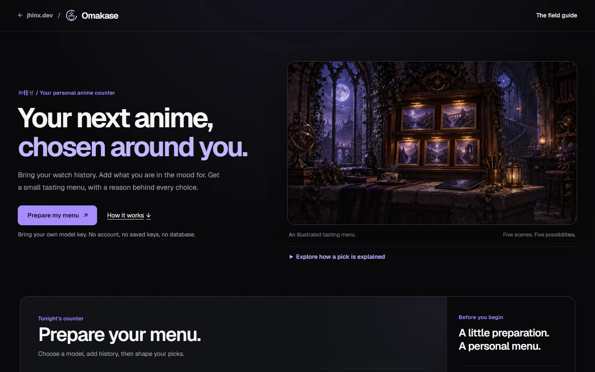
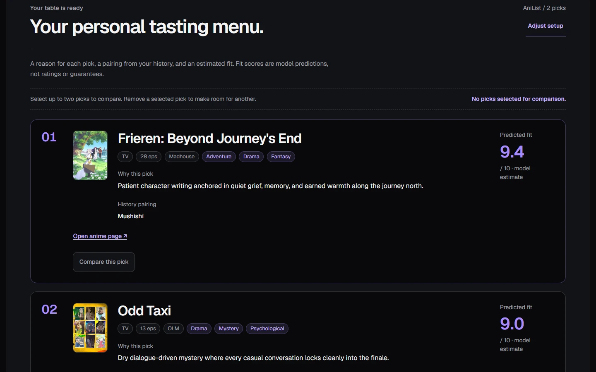

# Omakase

> お任せ means "I'll leave it to the chef."

Omakase is a stateless, Bring-Your-Own-Key (BYOK) anime sommelier. It pairs your scored watch history with a short description of your taste, then asks a model you choose to prepare a focused tasting menu with a reason for every pick.

[Try the public counter](https://omakase.jhinx.dev) · [Read the case study](https://jhinx.dev/projects/omakase) · [Visit jhinx.dev](https://jhinx.dev)

[](https://github.com/JhinxDev/omakase/actions/workflows/ci.yml)
[](https://www.python.org/downloads/)
[](LICENSE)



The web counter uses a Carbon Obsidian (`#09090B`) and Iris Atelier (`#A78BFA`) interface with self-hosted Geist typography. There are no user accounts, no database, and no stored provider keys: every web menu runs purely on the key and history you bring for that request. For a self-hosted anime, movie, and TV library, see [Omakase Plus](https://github.com/JhinxDev/omakase-plus) and its [setup guide](https://omakase-plus.jhinx.dev/docs/quickstart).



## What makes it different

Most recommendation systems know what is popular. Omakase tries to understand why a story worked for you.

It combines:

- your AniList history or MyAnimeList export;
- the scores and statuses already in that history;
- optional notes about themes, moods, characters, and patterns you value;
- an unwatched candidate pool;
- a model selected and paid for by you.

The result is a short tasting menu instead of an endless popularity feed. Each recommendation includes a predicted fit, an explanation, a title from your history that helped shape the match, and (when matched in AniList or MyAnimeList) cover artwork, format, episode count, studio, and genre badges.

## Public counter

The counter has three explicit steps: choose a model provider, add watch history, and shape the menu. You can return to an earlier step before requesting a menu.

The hosted site supports request-local keys for OpenAI, Anthropic, Gemini, DeepSeek, OpenRouter, and owner-approved OpenWebUI instances. Both Quick and Deep model presets run as background jobs, so a slower reasoning model can finish without holding one proxy request open. OpenWebUI asks for the instance URL and the exact model ID shown there. Choose the provider explicitly: several provider keys share similar prefixes, so Omakase routes exclusively to the provider you select.

Everything stays request-local. Your provider key, history, and taste notes are never written to disk, logs, cookies, or a database, and the key input is cleared as soon as the menu arrives. Your history and notes are sent only to the provider you select so it can generate the menu (that provider's own data policy applies).

The hosted counter accepts a public AniList username or a MyAnimeList XML export. Local model addresses (such as localhost Ollama or LM Studio) are intentionally disabled on the hosted instance because a public server cannot safely reach models running on your machine.

Set `OMAKASE_SOURCE_COMMIT` to the exact 40-character Git commit for every build and deploy. The image label and `/api/health` expose that value so the running public artifact can be checked against its source.

## Run it yourself

Self-hosting unlocks local Ollama, LM Studio, and OpenWebUI instances as well as all supported cloud providers.

```bash
pip install "git+https://github.com/JhinxDev/omakase.git"

# Create a starter taste profile
omakase init

# Use local Ollama with your AniList history
omakase recommend -u your-anilist-handle

# Or open the browser interface
omakase web
```

Install from source when developing:

```bash
git clone https://github.com/JhinxDev/omakase
cd omakase
pip install -e .
```

## Choose a model

The command line supports local and cloud backends. Cloud credentials can use `OMAKASE_API_KEY` or the provider-specific environment variable.

```bash
# OpenAI
export OMAKASE_API_KEY=your-key
omakase recommend -u your-handle --llm-type openai --mode pro

# Anthropic
export OMAKASE_API_KEY=your-key
omakase recommend -u your-handle --llm-type anthropic --mode pro

# Gemini
export OMAKASE_API_KEY=your-key
omakase recommend -u your-handle --llm-type gemini

# DeepSeek
export OMAKASE_API_KEY=your-key
omakase recommend -u your-handle --llm-type deepseek --mode pro

# OpenWebUI
export OMAKASE_API_KEY=your-openwebui-key
omakase recommend -u your-handle --llm-type openwebui \
  --llm-url https://models.example.com --model llama3.1:8b
```

Supported backends include Ollama, LM Studio, OpenWebUI, OpenAI, Anthropic, Gemini, DeepSeek, OpenRouter, Groq, and Together. Use `--model` to override a preset.

## The pipeline

```text
taste notes + scored history + unwatched candidates
                         |
                         v
                  selected model
                         |
                         v
       ranked picks + reasoning + history pairing
```

Omakase keeps its extension points small. Source adapters normalize watch history and candidates. Model adapters handle provider protocols. The recommendation engine builds one prompt and returns the same structured result to the terminal, JSON output, MCP client, or browser interface.

## Commands

| Command | Purpose |
| --- | --- |
| `omakase recommend -u <user>` | Prepare a recommendation menu |
| `omakase web` | Start the browser interface |
| `omakase mcp` | Run the stdio MCP server for AI agents |
| `omakase init` | Create a starter taste profile |
| `omakase sources` | List available history sources |
| `omakase backends` | List available model backends |

Run `omakase recommend --help` for all options. See [CONTRIBUTING.md](CONTRIBUTING.md) for development and extension guidance.

## MCP server

Run `omakase mcp` to expose three zero-dependency stdio tools (`omakase_list_sources`, `omakase_list_backends`, and `omakase_recommend`) to any MCP-compatible client:

```json
{
  "mcpServers": {
    "omakase": {
      "command": "omakase",
      "args": ["mcp"],
      "env": {
        "OMAKASE_API_KEY": "your-provider-key"
      }
    }
  }
}
```

## Hosted deployment

The Compose stack runs Omakase as a stateless BYOK container on port `8765` with zero database volumes or stored user secrets. To enable one or more OpenWebUI instances on the hosted counter, set `OMAKASE_OPENWEBUI_ALLOWED_ORIGINS` to a comma-separated list of exact HTTPS origins (for example, `https://models.example.com`):

```bash
OMAKASE_SOURCE_COMMIT=$(git rev-parse HEAD) docker compose up -d --build
```

## Scope

This public repository is strictly the stateless Bring-Your-Own-Key recommendation engine, CLI, web counter, and stdio MCP server. For a full self-hosted anime, movie, and TV media hub with web/tvOS/iOS players, see [Omakase Plus](https://github.com/JhinxDev/omakase-plus), which runs as a separate application and is not connected to this hosted demo.

## License

MIT. See [LICENSE](LICENSE).
